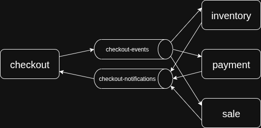

# Laboratorio Orquestación

## Requisitos

- Docker

## Introduccion

En este laboratorio podras observar un ejemplo de orquestacion de microservicios. El orquestador es el microservicio de
checkout. Los participantes de la transaccion son payment, sale e inventory.

El flujo del 2PC se basa en dos topicos de kafka:

- checkout-events: donde el orquestador difunde los mensajes de prepare y commit/rollback
- checkout-notifications: donde los participantes publican los votos y los ack.



## Instrucciones

Para correr los servicios solo necesitaran tener instalado docker.

```bash
docker compose up
```

Pueden visualizar los logs del orquestador y los participantes usando el comando `docker compose logs [..nombres servicios]

Para realizar una transaccion pueden utilizar la coleccion de Bruno incluida en el directorio tools/collection o simplemente
ejecutar:

```bash
curl --request POST \
  --url http://localhost:8080/checkout \
  --header 'content-type: application/json' \
  --data '{
  "productId": 1,
  "userId": 1,
  "unitPrice": 10,
  "amount": 10,
  "quantity": 1
}'
```

## Visualizacion de los topicos

Para visualizar los mensajes que entran hemos incluido en el compose la herramienta kafka-ui. Esta herramienta nos provee
de una interfaz web para poder inspeccionar kafka.

Para acceder abrir el navegador y dirigirse a `http://localhost:8090`
